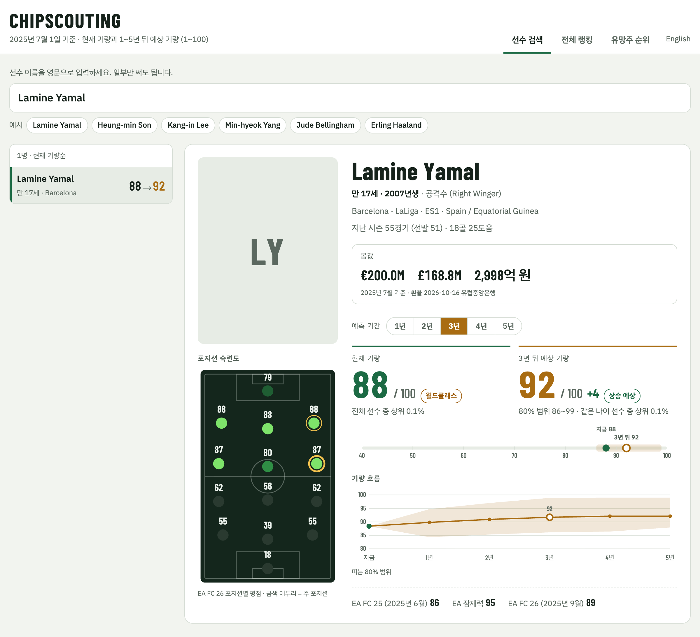
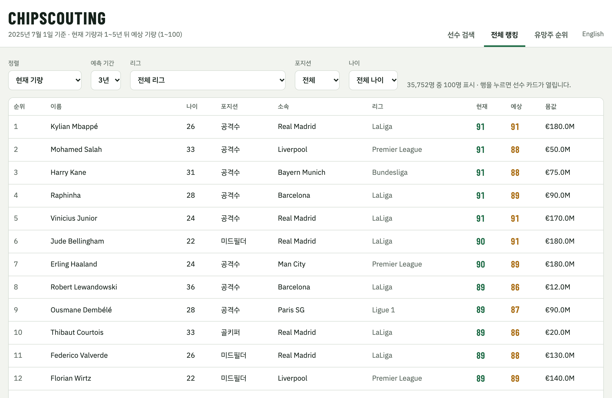
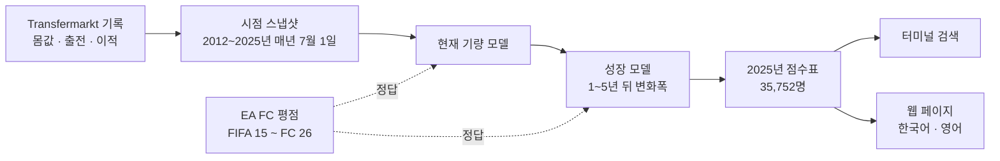
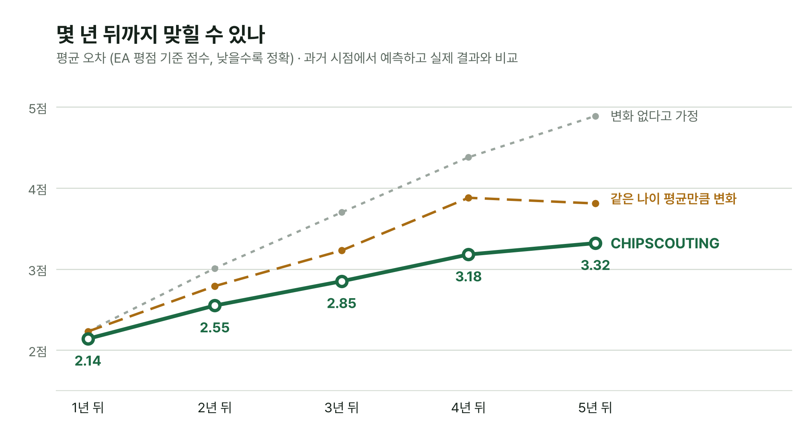

<div align="center">

# ⚽ CHIPSCOUTING

**축구 선수의 지금 기량과 1\~5년 뒤 기량을 1\~100 점수로 예측하는 AI 스카우팅 서비스**

[](https://www.python.org/)
[](https://lightgbm.readthedocs.io/)
[](https://pandas.pydata.org/)
[](#overview)
[](LICENSE)

[서비스 소개](#overview) · [작동 방식](#how-it-works) · [예측 기술](#prediction-techniques) · [참고하기](#use-as-a-reference) · [시작하기](#getting-started)

<br>



</div>

<br>

## Overview

> **2017년, FIFA 평점 58점짜리 17살 공격수가 4년 뒤 88점짜리 선수가 될 걸 미리 알아볼 수 있을까?**
>
> 그 선수는 엘링 홀란이었습니다.

CHIPSCOUTING은 이런 선수를 데이터로 미리 알아보는 스카우팅 서비스입니다. 선수 이름을 검색하면 두 가지 점수를 1\~100으로 보여줍니다.

| | 점수 | 뜻 |
|:---:|---|---|
| 🟢 | **현재 기량** | 지금 얼마나 잘하는 선수인가 |
| 🟠 | **N년 뒤 예상 기량** | 1\~5년 뒤 얼마나 잘하는 선수가 될까 (기간은 골라서 봅니다) |

Football Manager의 현재 능력(CA)과 잠재 능력(PA)을 실제 기록으로 매겨 보는 것과 비슷합니다. 점수는 EA SPORTS FC(FIFA) 평점과 같은 척도라서, 게임을 해 본 사람이라면 숫자만 봐도 감이 옵니다.

위 카드의 라민 야말은 지금 88점(전체 선수 중 상위 0.1%)이고, 3년 뒤에는 92점으로 예상됩니다. 과거 예측에서 10명 중 8명이 들어온 폭인 80% 범위(86\~99점)도 함께 보여줍니다.

### Features

| | 기능 | 내용 |
|:---:|---|---|
| 🔎 | **선수 검색** | 영문 이름 일부만 넣어도 2025년 7월 기준 선수 35,752명 중에서 찾습니다 |
| 📈 | **기량 예측** | 현재 기량, 1\~5년 뒤 예상 기량, 80% 범위, 같은 나이 선수 중 순위 |
| 🗺️ | **포지션 숙련도** | 축구장 위 14개 자리에 EA FC 26 포지션별 평점 |
| 💶 | **몸값** | 유로 · 파운드 · 원 |
| 🏆 | **전체 랭킹** | 리그, 포지션, 나이대로 걸러 보는 기량 순위 |
| 🌱 | **유망주 순위** | 나이 상한을 정하고 N년 뒤 기량이나 오를 점수로 정렬 |
| 🌐 | **한국어 · 영어** | 같은 내용을 두 언어로 |
| ⚡ | **서버 없이 동작** | 데이터를 페이지 안에 넣어 HTML 파일 하나로 검색 |

<p align="center">
  
</p>

## How It Works



| # | 하는 일 | 코드 |
|:---:|---|---|
| 1 | 2012\~2025년 매년 7월 1일, 그날 뛰던 15\~40세 선수의 기록을 모읍니다 (약 36만 건) | `01_build_dataset.py` |
| 2 | EA FC 평점을 Transfermarkt 선수와 연결합니다 | `01c_add_ea.py` |
| 3 | 현재 기량 모델과 1\~5년 성장 모델을 학습시키고, 과거 시점에서 시험한 뒤, 2025년 선수들에게 점수를 매깁니다 | `06_ability_models.py` |
| 4 | 터미널에서 이름으로 검색합니다 | `07_scout.py` |
| 5 | 환율을 받고 한국어·영어 웹 페이지를 만듭니다 | `08a_fetch_media.py` `08_build_web.py` |

**모델이 보는 정보**

| 묶음 | 예시 |
|---|---|
| 👤 선수 | 나이, 키, 포지션, 주발 |
| 💰 몸값 | 지금 몸값, 1\~2년 추세, 최고점 대비 하락 |
| ⚽ 경기 기록 | 최근 두 시즌의 출전, 선발, 골, 도움, 실점, 클린시트 |
| 🏟️ 수준 | 뛴 대회의 수준, 소속 클럽과 리그의 강도, 팀 안에서의 몸값 순위 |
| 🔁 이력 | 이적과 임대 횟수, 최고 이적료, 현 소속 기간 |
| 🎮 EA | 직전 EA 평점과 잠재력 (현재 기량 모델만) |

## Prediction Techniques

1\~5년 뒤 기량을 맞히기 위해 쓴 방법들입니다. 하나하나는 널리 쓰이는 기법이고, 축구 데이터에서 생기는 문제에 맞게 조합했습니다.

| | 기법 | 막아 주는 문제 |
|:---:|---|---|
| ① | 정답을 EA 평점으로 | 몸값에 섞인 나이, 계약, 시장 분위기 |
| ② | 시점 스냅샷 (point-in-time features) | 그때는 몰랐던 미래 정보가 입력에 새어 드는 것 (leakage) |
| ③ | 2단계 모델: 현재 기량 → 변화폭 | 트리 모델이 최고점 근처 예측을 평균 쪽으로 깎는 것 |
| ④ | 기간을 입력으로 넣은 하나의 모델 (multi-horizon) | 기간마다 모델을 따로 만들어 사례가 나뉘는 것 |
| ⑤ | 끊긴 정답 채우기 (label imputation) | 하부 리그로 내려간 선수가 빠져 모두를 낙관하는 것 (survivorship bias) |
| ⑥ | 공개 시점을 지키는 walk-forward 검증 | 미래 정답으로 학습해 성능이 부풀려지는 것 |
| ⑦ | 오차로 만든 80% 범위 | 예측을 얼마나 믿어도 되는지 모르는 것 |

### ① 정답: EA FC 평점

"잘한다"를 숫자로 정해야 모델이 배울 수 있습니다. 몸값에는 나이, 계약 기간, 시장 분위기가 섞여 있어서, EA가 해마다 1만 6천\~1만 9천 명을 같은 1\~99 척도로 매기는 평점을 정답으로 씁니다. 두 데이터에 공통 ID가 없어서, 생년월일이 같은 선수끼리 이름 규칙 4단계로 맞춰 EA 선수 3만 3천여 명(55%)을 연결했습니다.

### ② 시점 스냅샷

매년 7월 1일을 기준일로 정하고, **그날까지 알 수 있었던 정보만** 입력으로 씁니다. 2018년 7월 1일 행에는 2017/18 시즌까지의 기록만 들어갑니다. 몸값처럼 해마다 시세가 오르는 값은 그해 유망주들의 중앙값과 비교한 상대값으로 바꿔서, 연도가 달라도 같은 기준으로 볼 수 있게 했습니다.

### ③ 2단계 모델

> 2025년 7월까지의 기록 → **현재 기량 모델** → 지금 88점 → **성장 모델** → 3년 동안 +4점 → 3년 뒤 92점

- **현재 기량 모델** (LightGBM): 7월 1일까지의 기록과 직전 EA 평점으로 그해 9월에 나오는 EA 평점을 맞힙니다. EA가 평가하지 않는 선수에게도 점수를 줄 수 있습니다. 평균 오차는 처음 보는 선수 기준 1.44점, 2025년 추정 1.21점입니다.
- **성장 모델** (LightGBM): 미래 평점 자체가 아니라 **지금부터 몇 점 오르내리는지(변화폭)** 를 맞힙니다. 처음에 평점 자체를 맞혔더니 17세 야말의 3년 뒤가 지금과 같은 88점으로 나왔습니다. 90점 이상인 선수가 드물어서 트리 모델이 높은 점수를 평균 쪽으로 끌어내리기 때문입니다. 변화폭을 맞히게 하면 "17세는 보통 몇 점 오른다"를 점수가 낮은 선수들에게서도 배울 수 있습니다.

### ④ 기간을 입력으로 넣은 하나의 모델

선수 한 명의 한 시점 기록을 1\~5년 기간마다 한 번씩, 다섯 번 복사해 쌓고 기간(`horizon`)을 입력 열로 넣습니다. 모델 하나가 1년 뒤부터 5년 뒤까지의 변화를 함께 배우므로, 사례가 적은 먼 기간도 가까운 기간의 패턴을 함께 씁니다. 학습 표는 847,241행입니다.

### ⑤ 끊긴 정답 채우기

N년 뒤 EA가 평가하지 않는 리그로 내려간 선수에게는 정답이 없습니다. 이 선수들을 빼면 모델은 살아남은 선수만 보고 모든 유망주를 낙관하게 됩니다. 그래서 그 시점의 기록으로 추정한 현재 기량을 정답 대신 씁니다. 학습 표의 64%가 이렇게 채운 정답입니다.

### ⑥ 공개 시점을 지키는 walk-forward 검증

평가 연도(2019\~2022년)마다 **그해 7월 1일 전에 이미 공개된 정답**으로만 학습시키고, 그해 선수들의 1\~5년 뒤를 맞힙니다. 정답인 평점이 9월에 나온다는 점까지 따져서, 평가 시점보다 늦게 나온 정답은 학습에 쓰지 않습니다 (embargo).

### ⑦ 80% 범위

과거 평가에서 나온 오차(실제 − 예측)를 나이대와 기간별로 모아 아래 10%, 위 10% 지점을 잽니다. 어린 선수일수록, 먼 미래일수록 범위가 넓습니다.

| 나이 | 1년 뒤 | 3년 뒤 | 5년 뒤 |
|---|:---:|:---:|:---:|
| 19세 이하 | −5.4 ~ +4.9 | −5.6 ~ +7.1 | −4.2 ~ +9.2 |
| 24\~26세 | −3.3 ~ +3.0 | −4.2 ~ +4.5 | −3.8 ~ +5.8 |
| 30세 이상 | −2.8 ~ +2.9 | −3.9 ~ +3.7 | −4.7 ~ +4.6 |

### Results

<p align="center">
  
</p>

| 기간 | CHIPSCOUTING | 같은 나이 평균만큼 변화 | 변화 없다고 가정 |
|---|:---:|:---:|:---:|
| 1년 뒤 | **2.14점** | 2.23점 | 2.23점 |
| 2년 뒤 | **2.55점** | 2.79점 | 3.01점 |
| 3년 뒤 | **2.85점** | 3.23점 | 3.70점 |
| 4년 뒤 | **3.18점** | 3.88점 | 4.38점 |
| 5년 뒤 | **3.32점** | 3.81점 | 4.89점 |

숫자는 평균 오차이고, 낮을수록 정확합니다. N년 뒤에도 EA 평점이 있는 선수로 채점했습니다. 1\~4년 뒤는 2019\~2022년 시점 평가를 합친 결과입니다. 5년 뒤는 조건을 지키면 평가할 해가 없어서, 2020년 시점에서 공개 시점 조건을 한 해 늦춰 평가했습니다.

### What Didn't Work

| 시도 | 결과 |
|---|---|
| 몸값 상승률을 정답으로 | 몸값에는 실력 밖의 요소가 많아서 EA 평점으로 바꿨습니다 |
| FBref 경기 세부 지표 (터치, 패스, 태클 등 40개) | 넣어도 현재 기량 오차가 거의 줄지 않았습니다 (1.180 → 1.179점). 몸값과 직전 EA 평점에 이미 들어 있는 정보로 보입니다 |
| 포지션별로 모델 나누기 | 몸값 예측 단계에서 시험했는데, 포지션마다 사례가 3분의 1로 줄어 오히려 나빠졌습니다 |
| 처음 쓴 공개 데이터셋 | 오래된 선수의 소속과 몸값이 2023년에 멈춰 있어서 다른 데이터셋으로 바꿨습니다 |

## Use as a Reference

축구가 아니어도 비슷한 문제를 풀 때 참고할 수 있는 부분입니다.

| 이런 걸 만든다면 | 참고할 부분 | 파일 |
|---|---|---|
| 시간에 따라 변하는 대상의 미래 예측 (학생 성적, 고객 이탈, 신용 점수 등) | 시점 스냅샷, 공개 시점을 지키는 walk-forward 검증 | `01_build_dataset.py` `common.py` `06_ability_models.py` |
| 1년, 3년, 5년 뒤를 한 번에 예측 | 기간을 입력 열로 넣고 행을 쌓는 방식 | `06_ability_models.py` |
| 정답이 일부만 있는 데이터 | 끊긴 정답을 추정값으로 채우기 | `06_ability_models.py` |
| 예측과 함께 불확실성 보여주기 | 기간·나이대별 오차 분위수로 만든 범위 | `06_ability_models.py` |
| 공통 ID가 없는 두 데이터 연결 | 생년월일 + 이름 정규화 규칙 | `01c_add_ea.py` |
| Transfermarkt 데이터로 축구 분석 시작하기 | 몸값, 이적, 출전 기록을 시점별 표로 바꾸기 | `01_build_dataset.py` |
| 서버 없이 수만 건을 검색하는 페이지 | 열 단위 배열, 반복 값 번호 매기기, 10배 정수, 언어별 틀 | `08_build_web.py` |

## Getting Started

**1. 환경 만들기**

```bash
git clone https://github.com/chipkkang9/CHIPSCOUTING.git
cd CHIPSCOUTING
conda env create -f environment.yml
conda activate scout
```

**2. 데이터 받기** (Kaggle 공개 데이터셋)

| 넣을 곳 | 파일 | 받는 곳 |
|---|---|---|
| `data/raw_salimt/` | `player_profiles.csv` `player_market_value.csv` `transfer_history.csv` `player_performances.csv` | [Football Datasets](https://www.kaggle.com/datasets/xfkzujqjvx97n/football-datasets) |
| `data/raw_ea/fc24_all/` | `male_players.csv` | [FIFA 15 ~ FC 24](https://www.kaggle.com/datasets/stefanoleone992/ea-sports-fc-24-complete-player-dataset) |
| `data/raw_ea/fc25_sofifa/` | `player-data-full-2025-june.csv` | [FC 25](https://www.kaggle.com/datasets/aniss7/fifa-player-data-from-sofifa-2025-06-03) |
| `data/raw_ea/fc26_sofifa/` | `FC26_20250921.csv` | [FC 26](https://www.kaggle.com/datasets/rovnez/fc-26-fifa-26-player-data) |

**3. 실행**

```bash
python src/01_build_dataset.py              # 시점 스냅샷 (약 36만 건)
python src/01c_add_ea.py                    # EA 평점 연결
python src/06_ability_models.py             # 학습, 평가, 2025년 점수 매기기
python src/07_scout.py Lamine Yamal         # 선수 검색 (--years 1~5로 기간 선택)
python src/07_scout.py --top 20             # 21세 이하 유망주 순위
python src/08a_fetch_media.py               # 환율 (--photos를 붙이면 선수 사진 주소도)
python src/08_build_web.py                  # web/index.html (한국어), web/en.html (영어)
```

만들어진 `web/index.html`을 브라우저로 열면 됩니다.

## Project Structure

```
CHIPSCOUTING/
├── src/
│   ├── common.py               # 공통 설정, 입력 만들기, 평가 함수
│   ├── 01_build_dataset.py     # 매년 7월 1일 기준 선수 스냅샷
│   ├── 01c_add_ea.py           # EA FC 평점 연결
│   ├── 06_ability_models.py    # 현재 기량 + 1~5년 성장 모델, 평가, 최종 점수
│   ├── 07_scout.py             # 터미널 검색
│   ├── 08a_fetch_media.py      # 환율 (선택: 선수 사진 주소)
│   ├── 08_build_web.py         # 한국어·영어 웹 페이지
│   ├── check_dataset.py        # 데이터 품질 점검
│   ├── 01b_add_fbref.py        # 실험: FBref 세부 지표 연결
│   ├── 02_baselines.py         # 초기: 몸값 상승 기준선
│   ├── 03_train_gbdt.py        # 초기: 몸값 상승 LightGBM
│   ├── 04_compare_fbref.py     # 실험: 세부 지표 효과 비교
│   └── 05_position_models.py   # 실험: 포지션별 모델
├── assets/                     # README 그림
├── outputs/                    # 초기 몸값 모델 그림
└── environment.yml
```

## Data & Credits

| 데이터 | 출처 | 쓰임 |
|---|---|---|
| 선수 기록 | Transfermarkt 기반 [공개 데이터셋](https://www.kaggle.com/datasets/xfkzujqjvx97n/football-datasets) (선수 9만 3천 명, 몸값 85만 건, 이적 110만 건, 출전 188만 건) | 입력 |
| 기량 평가 | EA SPORTS FC / FIFA 평점 (sofifa 기반 Kaggle 데이터셋 3종) | 정답, 포지션 숙련도 |
| 환율 | 유럽중앙은행(ECB) 기준 환율 | 몸값 표시 |
| 선수 사진 (선택) | 위키데이터, 위키미디어 공용의 자유 라이선스 사진 | `--photos`로 받을 때만 촬영자, 라이선스와 함께 표시 |
| 경기 세부 지표 | FBref 기반 5대 리그 기록 (Kaggle) | 실험에만 사용 |

데이터, 학습된 모델, 만들어진 웹 페이지는 저장소에 넣지 않았습니다. 각 데이터의 권리는 원래 제공자에게 있습니다. 이 프로젝트는 개인 학습 프로젝트이며 EA, Transfermarkt, FBref와 관련이 없습니다.

## Limitations

- **기량의 기준이 EA 평점입니다.** 사람이 매긴 평가라 틀릴 수 있고, 유명한 리그와 선수를 더 높게 볼 수 있습니다.
- **성장 가능성은 5년 뒤까지만 봅니다.** "최고 도달점"이 아니라 N년 뒤 예상 기량이라, 나이 많은 선수는 현재 기량보다 낮게 나옵니다. 먼 미래일수록 오차가 커집니다.
- **기준 시점이 2025년 7월입니다.** 공개 데이터가 2025년 9월까지라 그 이후의 활약은 반영되지 않습니다.
- **몸값이 매겨진 선수만 다룹니다.** Transfermarkt에 최근 몸값 기록이 없는 선수는 검색되지 않습니다.
- **성장 모델이 배우는 정답의 64%가 추정값입니다.** 현재 기량 모델의 오차가 함께 섞입니다.

## Motivation

대학원 입학 전에 AI를 **직접 학습시켜 보는 경험**을 쌓고 싶어서 시작했습니다. 만들어진 모델을 불러와 쓰는 대신, 데이터를 모으고 다듬는 것부터 학습, 검증, 서비스까지 전 과정을 손으로 해 보는 것이 목표였습니다. 주제는 재미있어야 오래 한다는 생각으로 축구를 골랐습니다.

## License

코드는 [MIT License](LICENSE)를 따릅니다. 데이터는 저장소에 포함되어 있지 않으며 각 출처의 이용 조건을 따릅니다.
